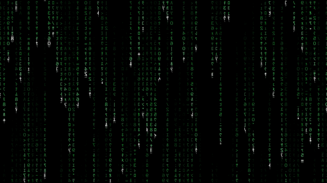

# Déjà Vu Rain

A free macOS app that draws a falling rain of green code on your desktop, behind your windows and icons.



## Features

- Half-width katakana, numbers, and symbols, mirrored, with a white head and a trail that fades to black
- 8 colors plus **Mixed**, where every new drop falls in its own random color
- 3 speeds, 3 densities, 4 brightness levels, and a choice of which displays show the rain
- Changes never restart the rain: each drop keeps the settings it started with, so only new drops use the new ones
- Global shortcut `⌃⌥⌘R` to pause and resume
- Pauses by itself when the display sleeps or windows cover the desktop, with an optional pause on battery power
- Respects **Reduce Motion** by freezing the rain on a single frame
- Menu bar app with no Dock icon, and an optional Open at Login
- No accounts, no ads, no tracking, and no network access. Only your preferences are saved, on your Mac
- Universal binary for Apple silicon and Intel, macOS 15 or later

## How it works

macOS has no public API for [third-party animated wallpapers](https://github.com/vlzuiev/animated), so the app opens one borderless window per display at the desktop window level, below every other window, ignoring the mouse, on all Spaces. The rain does not appear in System Settings or on the lock screen.

- `RainEngine.swift` is the simulation. It knows nothing about windows or Metal, so it could drive another front end, such as a screen saver.
- `RainRenderer.swift` draws it with Metal. A glyph atlas is rendered once with Core Text, and each glyph is an instanced quad. The shader is compiled at runtime from a string, so no separate Metal toolchain is needed.
- `App.swift` creates the windows and the menu bar item, and pauses the animation when nobody can see it.
- `Settings.swift` holds the menu choices, saved in `UserDefaults`.
- `Welcome.swift` is the first-run window, in SwiftUI.

## Building

You need Xcode and macOS 15 or later. The project was developed with Xcode 27.2.

1. Open `DejaVuRain.xcodeproj`.
2. In **Signing & Capabilities**, choose your own team and change the bundle identifier. The project currently uses the author's.
3. Run the `DejaVuRain` scheme.

For a universal release build:

```bash
xcodebuild -project DejaVuRain.xcodeproj -scheme DejaVuRain -configuration Release \
  -destination 'generic/platform=macOS' build
```

A debug build from Xcode uses noticeably more CPU than a release build.

## Privacy

The app collects no data. Read the [privacy policy](https://chicletes.jaymebc.com/privacidade/).

## License

The code is released under the [MIT License](LICENSE).

The name "Déjà Vu Rain" and the app icon are not covered by that license. Please do not publish builds under this name or icon.

Made by Jayme Bueno de Castilho, on [Chicletes para o Cérebro](https://chicletes.jaymebc.com).
